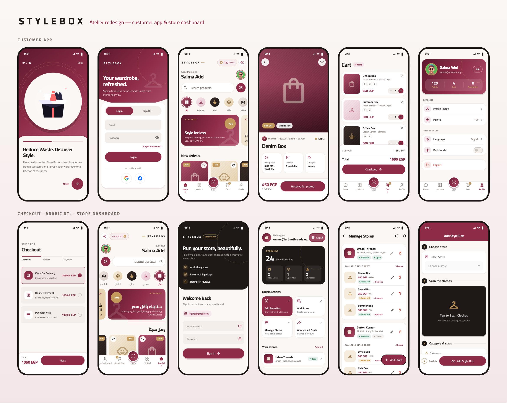

<h1 align="center">StyleBox</h1>

<p align="center">
  <b>Reduce waste. Discover style.</b><br/>
  A two-app Flutter platform where local fashion stores sell discounted "Style Boxes" of surplus clothes — with on-device ML clothing recognition and a Gemini-powered style assistant.
</p>

<p align="center">
  
  
  
  
  
  
</p>

<p align="center">
  
  <br/><sub>Home · Style scan · AI style assistant</sub>
</p>

---

## 📖 About

StyleBox connects shoppers with nearby fashion stores that have overstock and end-of-season clothes. Stores pack surplus items into discounted **Style Boxes**; customers browse, reserve and pick them up. The repo is a small monorepo with two Flutter apps that share one Firebase project:

| App | Folder | For |
|---|---|---|
| 🛍 **StyleBox** | [`app/`](app) | Customers — browse stores and boxes, reserve, pay, find stores on a map, chat with the AI stylist |
| 🏬 **StyleBox Dashboard** | [`dashboard/`](dashboard) | Store owners — manage stores and branches, scan clothes with ML Kit to create boxes, view analytics |

Both apps use Clean Architecture with Bloc/Cubit, are fully bilingual (English / Arabic), and share Firestore security rules that let owners manage their own stores while customers can only reserve and review.

## ✨ Features

### 🛍 Customer app (`app/`)
- 🔐 **Authentication** — email/password, Google and Facebook sign-in (Firebase Auth)
- 👋 **Onboarding** flow with page indicators
- 🏪 **Stores & Style Boxes** — browse stores, see boxes left, old vs. new price, reserve for pickup
- ⭐ **Reviews** — product reviews streamed live from Firestore with rating analytics
- 🛒 **Cart & checkout** — cash on delivery, PayPal, or Visa card form (`flutter_credit_card`)
- 🗺 **Stores map** — OpenStreetMap tiles (`flutter_map`), current location (`geolocator`), driving routes via OSRM and a "open in Google Maps" hand-off
- 📸 **AI style scan** — on-device clothing recognition with ML Kit image labeling, plus a Gemini vision analysis through a proxy
- 💬 **AI stylist chat** — Gemini chat about boxes, sizes, pickup and outfit tips
- 🎁 **Points & rewards** page, favourites, avatar picker
- 🌍 **English / Arabic** localization and 🌙 **light / dark** theme

### 🏬 Store-owner dashboard (`dashboard/`)
- 🔐 Owner login (Firebase Auth)
- 🏬 **Store management** — create, edit and delete stores and branches, with a map-based location picker
- 🤖 **Scan clothes & add boxes** — ML Kit object detection draws a box around each piece, image labeling names it, and the owner verifies the detected items before saving
- 🖼 Product images uploaded to **Supabase Storage**
- 📊 **Analytics & stats** — total stores, total reviews, latest reviews
- 🌍 English / Arabic, skeleton loading states (`skeletonizer`)

## 🛠 Tech stack

| Concern | Choice |
|---|---|
| Framework | Flutter, Dart 3 |
| State management | `bloc` / `flutter_bloc` (Cubits) |
| Architecture | Clean Architecture (data / domain / presentation per feature), `get_it` DI, `dartz` `Either` for errors |
| Backend | Firebase Auth, Cloud Firestore, Cloud Functions; Supabase Storage for images |
| On-device ML | `google_mlkit_image_labeling`, `google_mlkit_object_detection` |
| Generative AI | Gemini through a Cloudflare Worker (`app/worker.js`) or Firebase Function (`app/functions/`) proxy, so the API key never ships in the app |
| Maps | `flutter_map`, `latlong2`, `geolocator`, OSRM routing |
| Payments | `flutter_paypal_payment`, `flutter_credit_card` |
| Localization | `flutter_localizations` + ARB files (`gen-l10n`) |
| CI | GitHub Actions workflow that builds the Android APK (`app/.github/workflows/main.yml`) |

## 🏗 Project structure

```
stylebox/
├── app/                      # Customer app
│   ├── lib/
│   │   ├── core/             # services, repos, cubits (locale, theme, avatar), widgets
│   │   ├── features/
│   │   │   ├── auth/  onBoarding/  splash/
│   │   │   ├── home/         # stores, boxes, cart, profile, reviews
│   │   │   ├── check_out/    # cash / PayPal / Visa
│   │   │   ├── stores_map/   # OSM map + OSRM routes
│   │   │   ├── food_scan/    # AI style scan (ML Kit + Gemini vision)
│   │   │   └── ai_chat/      # Gemini stylist chat
│   │   └── l10n/             # app_en.arb, app_ar.arb
│   ├── functions/            # Firebase Function: /chat and /vision Gemini proxy
│   ├── worker.js             # Cloudflare Worker alternative proxy
│   └── firestore.rules       # shared security rules
├── dashboard/                # Store-owner app
│   └── lib/
│       ├── core/services/    # ML Kit detection, Supabase storage, Firestore
│       └── features/         # auth, dashboard, add_product, manage_data, analytics
└── supabase_setup.sql        # storage bucket + policies for product images
```

## 🚀 Getting started

**Prerequisites:** Flutter SDK (Dart `^3.10`), a Firebase project, a Supabase project, and a Gemini API key for the AI features.

```bash
git clone https://github.com/youssef336/stylebox.git
cd stylebox

# Customer app
cd app && flutter pub get && flutter run

# Store-owner dashboard
cd ../dashboard && flutter pub get && flutter run
```

**Configuration**
1. **Firebase** — run `flutterfire configure` in each app to point it at your own project, and deploy `app/firestore.rules`.
2. **Supabase** — run `supabase_setup.sql` in the Supabase SQL editor to create the `product_images` bucket, then set your URL and anon key in `dashboard/lib/core/utils/supabase_key.dart`.
3. **Gemini proxy** — deploy `app/worker.js` to Cloudflare Workers with a `GEMINI_API_KEY` secret (or deploy `app/functions/` with `gemini.key` config), then replace `https://YOUR-WORKER.workers.dev` in `app/lib/features/ai_chat/...` and `app/lib/features/food_scan/...`.

**Backend in use**

| Service | Project | Used for |
|---|---|---|
| Firebase | `stylebox-af5fe` | Auth (Email/Password + Google), Firestore (`users`, `resturants`, `orders`, `chats/{uid}/messages`) |
| Supabase | `azfhmdgekgykkdyeudfu` (eu-west-1) | Storage bucket `product_images` for product and store images |

> **Google Sign-In on Android** needs the SHA-1 of the keystore that signs the build. Get it with
> `keytool -list -v -keystore ~/.android/debug.keystore -storepass android` and add it under
> *Firebase → Project settings → Your apps* for both `com.stylebox.app` and `com.stylebox.dashboard`.

**Quality checks** (also run by GitHub Actions on every push and PR, see `.github/workflows/ci.yml`)

```bash
cd app && flutter analyze && flutter test
cd ../dashboard && flutter analyze && flutter test
```

**Release APK**

```bash
cd app && flutter build apk --release        # build/app/outputs/flutter-apk/app-release.apk
cd ../dashboard && flutter build apk --release
```

## 👤 Author

**Youssef Belal Zakaria** · [GitHub @youssef336](https://github.com/youssef336)

⭐ If you like this project, give it a star!
